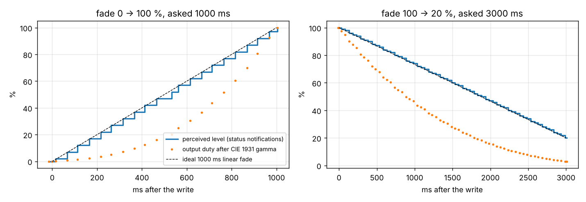
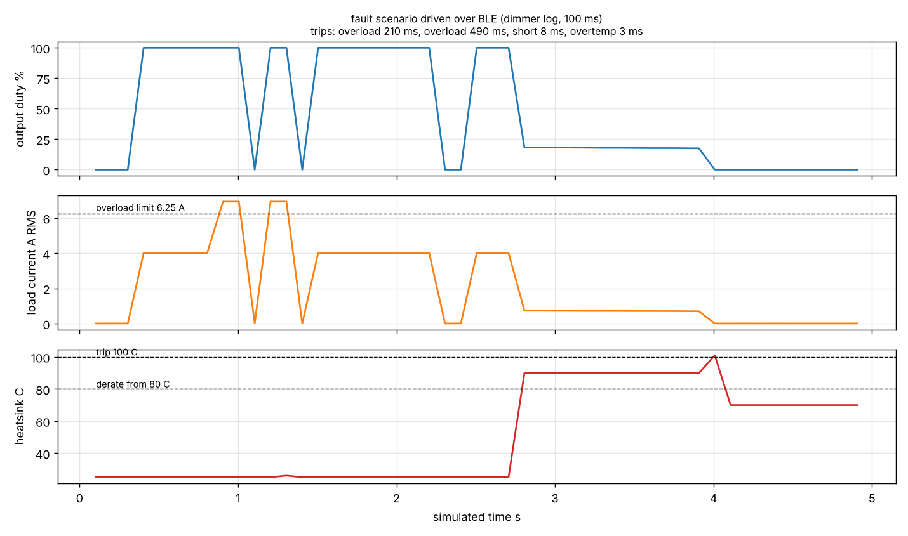

# BLE Smart Dimmer Firmware on Zephyr RTOS

[](https://github.com/vansh0906/ble-smart-dimmer-zephyr/actions/workflows/ci.yml)

Firmware for a Bluetooth Low Energy wall dimmer (120 V, 600 W LED load) written on **Zephyr RTOS v4.2.0**. It builds for
**`nrf52_bsim`**, Zephyr's simulated Nordic nRF52 board, and is tested **over the air**: a second Zephyr image plays the
phone app and drives the dimmer through its GATT service on BabbleSim's simulated 2.4 GHz channel. The real Zephyr BLE
host and link-layer controller run on both sides.

```
python3 tools/run.py | tee results.txt      # 3 builds, 21 unit tests, 8 BLE simulations, 13 requirements
```

## What the firmware does

| Area | Implementation |
|---|---|
| Control loop | Event-driven: a 10 ms `k_timer` tick reads the power stage, runs protections, fades and derating, and sets the output duty; BLE writes arrive between ticks |
| Dimming | Perceived level 0–100 %, CIE 1931 lightness gamma to duty, linear fades of 0–10 000 ms, on/off/toggle keep the last level |
| Protections | Short circuit (peak > 21.2 A) trips on the next tick; overload (> 6.25 A RMS for 200 ms); thermal derating 80–95 °C down to 25 %, trip at 100 °C, reset only below 80 °C; mains loss (no zero crossing for 25 ms) turns the output off and resumes at the same level |
| Faults | Latched; commands are refused with ATT 0x80 while in fault; a reset is refused with 0x81 while the heatsink is still hot; after a reset the output stays off |
| Metering | 6 kHz sampling, 12-bit ADC model; Vrms, Irms, real power, power factor and energy over a 100 ms window |
| Persistence | On/off, level and fade time stored with Zephyr Settings on NVS flash (writes debounced 500 ms) and restored at boot with a fade-up |
| BLE | Peripheral, custom 128-bit GATT service; writes need an encrypted link; status and meter notifications; advertising restarts after a disconnect |

### GATT service `6d0c0001-4c5a-4d1e-9a3b-1f2e3d4c5b6a`

| Characteristic | UUID | Access | Format |
|---|---|---|---|
| Level | `…0002` | read, write (encrypted) | u8 0–100 |
| Fade time | `…0003` | read, write (encrypted) | u16 ms 0–10 000 |
| Command | `…0004` | write (encrypted) | u8: 1 on, 2 off, 3 toggle, 4 reset fault |
| Status | `…0005` | read, notify | state, target, level, faults, flags, temperature, fade |
| Meter | `…0006` | read, notify | power 0.1 W, energy mWh, Vrms 0.1 V, Irms mA, PF % |
| Test hook | `…00F0` | test image only (`CONFIG_APP_TEST_HOOKS`) | inject overload, short, temperature, mains loss; read true power |

ATT errors: 0x05 not encrypted, 0x0D bad length, 0x13 value out of range, 0x80 in fault, 0x81 cause still present.

## Layout

```
app/                 Zephyr application (prj.conf, Kconfig, test.conf)
  src/main.c         boot, settings, 10 ms control loop, logging
  src/ble_svc.c      GATT service, advertising, connection callbacks
  src/power_stage_sim.c   simulated mains, LED load, ADC and heatsink (the HAL boundary)
lib/dimmer.c         dimmer core: states, fades, gamma, protections (no Zephyr dependency)
lib/meter.c          RMS / power / PF / energy
tests/unit/          21 host unit tests for lib/ (any C compiler, macOS included)
tests/central/       test "phone": Zephyr BLE central with 8 scenarios (bstests)
tools/run.py         builds everything, runs the scenarios on BabbleSim, checks R1–R13
tools/plot.py        fade curves and the fault timeline
west.yml             Zephyr v4.2.0 + only the modules this build needs
.github/workflows/ci.yml   unit tests on Linux + macOS, full BLE simulation on Ubuntu
```

## Results (reference run, `docs/reference_run.txt`)

| ID | Requirement | Result | Target | Status |
|---|---|---|---|---|
| R1 | Firmware builds warning-free (3 images) | 3/3, 0 warnings | 3/3, 0 | PASS |
| R2 | Host unit tests (dimmer core, meter) | 21/21 | all | PASS |
| R3 | BLE: connect and discover all 6 characteristics | 6/6 | 6/6 | PASS |
| R4 | Writes need encryption; accepted after pairing | 0x05, then security level 2 | rejected, then ok | PASS |
| R5 | Bad writes rejected with ATT errors, no change | 4/4 | 4/4 | PASS |
| R6 | Fades take the time asked (±2 %), monotonic | 1005 / 3007 ms | 1000 / 3000 ms | PASS |
| R7 | Metering: power within 2 % at 4 levels | worst 0.9 % | ≤ 2 % | PASS |
| R8 | Short ≤ 10 ms, overload 200–220 ms, re-trips | 8 / 210 ms | ≤ 10 / 200–220 ms | PASS |
| R9 | Overtemperature: derate, trip at 100 °C, reset only when cool | 80 W at 90 °C, trip 3 ms | derate, trip, 0x81 | PASS |
| R10 | Mains loss: off ≤ 30 ms, resumes at the same level | 25 ms | ≤ 30 ms | PASS |
| R11 | Link loss: output unchanged, a new phone reconnects | supervision timeout 0x08, level kept | 0x08, same | PASS |
| R12 | Power cycle: on, level and fade restored from flash | 35 %, 800 ms | 35 %, 800 ms | PASS |
| R13 | 300 random commands over BLE: no mismatch, no error | 0 / 0 | 0 / 0 | PASS |




## Running it

BabbleSim and `nrf52_bsim` are **32-bit x86 Linux** programs, so the full run needs Linux (Ubuntu, WSL2 or a GitHub
Codespace).

- **GitHub Actions (no setup):** push the repo; the `ble-sim` job builds everything and uploads `results.txt`, the plots
  and all device logs as the `results` artifact.
- **Linux / Codespaces:** `bash tools/setup_linux.sh`, then `. ../env.sh && python3 tools/run.py | tee results.txt`.
- **macOS:** host unit tests only: `make -C tests/unit && ./tests/unit/build/unit_tests`.

## Limitations (what this is and is not)

- The nRF52 is the **simulated** `nrf52_bsim` board (Nordic's nRF52833 peripheral models plus the Zephyr BLE controller),
  not silicon. The radio channel is BabbleSim's ideal channel.
- The **power stage is a model** (`power_stage_sim.c`): mains, LED load, ADC and heatsink are simulated, and faults are
  injected through a test-only characteristic that is not compiled into the product image. On hardware this file would
  be replaced by a triac/MOSFET driver, zero-cross interrupt and ADC driver.
- Pairing is Just Works (security level 2: encrypted, no MITM protection). In the simulation the link layer runs
  without real AES encryption (BabbleSim's default), so encryption is checked at the GATT permission level.
- The protection limits are modelled on a 600 W, 120 V dimmer; they are not taken from a product certification.
